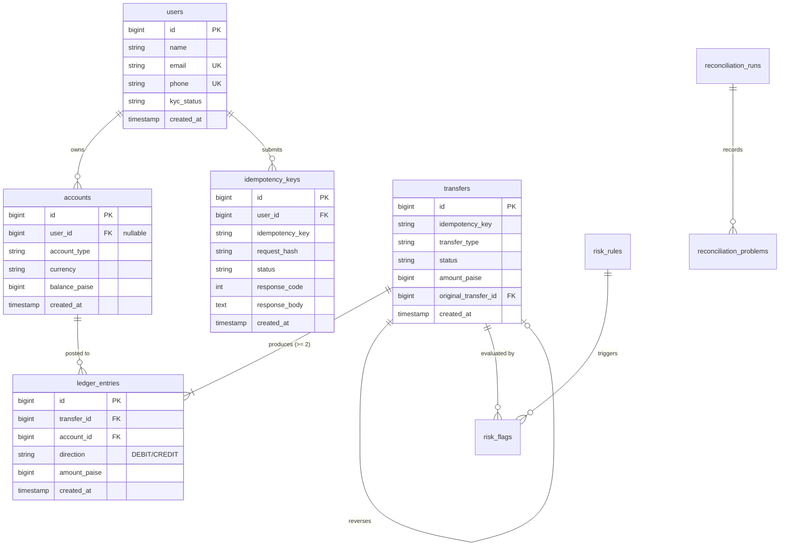

# Milestone 1: Schema Design & Double-Entry Ledger Architecture

## 1. Domain Modeling: Noun Extraction & Table Decisions

To model a production payments-grade ledger, we extract all nouns from the business requirements and evaluate their persistence needs:

| Candidate Noun | Decision | Architectural Rationale |
|---|---|---|
| **User** | **Table (`users`)** | Core actor possessing KYC status, personal details, and ownership of multiple financial wallets. |
| **Wallet / Account** | **Table (`accounts`)** | Financial balance container. Holds monetary value in whole paise. Includes both user wallets and system accounts. |
| **Transfer** | **Table (`transfers`)** | The business transaction event (top-up, peer transfer, withdrawal, reversal). Captures business intent and state. |
| **Ledger Entry** | **Table (`ledger_entries`)** | Immutable atomic debit or credit line. At least two entries per transfer. Balanced to zero net sum. |
| **Idempotency Key** | **Table (`idempotency_keys`)** | Deduplication record guaranteeing exactly-once execution per (user, key) pair under client retries. |
| **Risk Rule** | **Table (`risk_rules`)** | Configurable fraud thresholds and operational policies kept outside of hardcoded logic. |
| **Risk Flag** | **Table (`risk_flags`)** | Audit of rule firings, hold decisions, and AI-assisted triage explanations. |
| **Job Lock** | **Table (`job_locks`)** | Distributed mutual exclusion lock row preventing concurrent execution of scheduled jobs. |
| **Reconciliation Run** | **Table (`reconciliation_runs`)** | Historical log of nightly verification execution cycles and aggregated audit metrics. |
| **Reconciliation Problem** | **Table (`reconciliation_problems`)** | Granular discrepancies identified by reconciliation checks without mutating historical ledger lines. |
| **Audit Log** | **Table (`audit_logs`)** | Immutable chronological record of transfer status transitions, actor identity, and reasons. |
| *Rupee / Paise* | *Attribute (`amount_paise`)* | Unit of currency. Stored as `BIGINT` in whole paise (1 INR = 100 paise). |
| *Currency* | *Attribute (`currency`)* | Fixed to `'INR'`. Maintained as a column constraint on accounts. |
| *KYC Status* | *Attribute (`kyc_status`)* | State machine attribute on `users`. |

---

## 2. Cardinality Decisions & Relationships

1. **User to Account (1 : M)**
   - A single user can hold multiple wallets (e.g., primary checking, savings vault).
   - Foreign key `user_id` resides in `accounts`. For system accounts (`CASH_IN`, `CASH_OUT`, `FEE_REVENUE`), `user_id` is `NULL`.
2. **Transfer to Ledger Entry (1 : M, M ≥ 2)**
   - Double-entry accounting mandates that every transfer produces at least one debit and one credit.
   - Foreign key `transfer_id` resides in `ledger_entries`.
3. **Account to Ledger Entry (1 : M)**
   - An account accrues many debit and credit entries over time.
   - Foreign key `account_id` resides in `ledger_entries`.
4. **Transfer to Transfer (1 : 1 Self-Reference for Reversals)**
   - When correcting mistakes, an immutable reversal transfer references `original_transfer_id`.
5. **User to Idempotency Key (1 : M)**
   - Scoped uniquely per user: `UNIQUE(user_id, idempotency_key)`.

---

## 3. Entity-Relationship (ER) Diagram



---

## 4. Key Architectural Questions Answered

### Q1: Do you store each account's balance, compute it from ledger entries, or both? What does each option cost you?
**Decision: Both (Stored Balance with Nightly Computed Invariant Reconciliation).**
- **Option A (Compute only)**: `SELECT SUM(...) FROM ledger_entries WHERE account_id = ?`.
  - *Cost*: $O(N)$ read complexity where $N$ is the number of historical transactions. For an active account with $100,000$ transactions, every balance check and transfer pre-flight requires scanning thousands of index pages. This causes unacceptable latency spikes and lock contention under high TPS.
- **Option B (Store only without immutable ledger)**: Simply updating `accounts.balance_paise`.
  - *Cost*: Zero auditability. In the event of race conditions, software bugs, or silent database corruptions, money vanishes or appears with no trail.
- **Option C (Both - Our Approach)**:
  - We store `balance_paise` on `accounts` as a cached materialized balance updated inside the same atomic transaction under row locks (`SELECT ... FOR UPDATE`).
  - Read queries for user balances take $O(1)$ time.
  - The immutable truth remains in `ledger_entries`. The nightly reconciliation job calculates `SUM(credits) - SUM(debits)` and asserts exact equality with the stored balance, raising discrepancies immediately if any drift occurs.

### Q2: Why store user wallets and system accounts in the same table?
- **Unified Transfer Logic**: In double-entry bookkeeping, money cannot be created or destroyed. A user top-up is a transfer from the system `CASH_IN` account to the user wallet. A withdrawal is a transfer from the user wallet to `CASH_OUT`. A fee deduction moves funds to `FEE_REVENUE`.
- Storing all balance-holding entities in `accounts` allows every transfer to use the identical, battle-tested transfer pipeline:
  ```sql
  -- Lock accounts in strictly ascending ID order
  SELECT id, balance_paise FROM accounts WHERE id IN (accA, accB) ORDER BY id FOR UPDATE;
  ```
- No polymorphic queries, separate code paths, or duplicate ledger tables are required.

### Q3: Which columns hold data you don't control, such as phone or email? Why is none of them a primary key?
- **Columns**: `email` and `phone` are external identifiers provided by users and external telecom/mail providers.
- **Why they must NEVER be Primary Keys**:
  1. **Mutability**: Users change phone numbers and emails (e.g. SIM swap, company email change). Updating a primary key requires cascading foreign key updates across millions of transaction lines, leading to table locks and distributed downtime.
  2. **Storage and Index B-Tree Efficiency**: A surrogate `BIGINT` (8 bytes) creates a compact, dense B-tree index with high fan-out and sequential I/O performance. Variable-length strings like `user_xyz@domain.corporate.com` (30–60 bytes) bloat index pages by 400%+.
  3. **Privacy and Leakage**: Primary keys are frequently logged, exposed in routing URLs, and shared across services. Using surrogate IDs protects PII from leaking into APM traces and logs.
